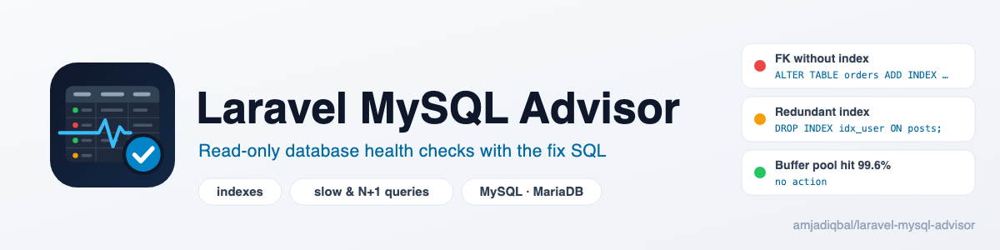

  <picture>
    <source media="(prefers-color-scheme: dark)" srcset="art/banner-dark.png">
    
  </picture>

# Laravel MySQL Advisor

A read-only health advisor for the MySQL or MariaDB database behind your Laravel app. It finds
unused and missing indexes, slow and N+1 queries, unhealthy tables and server pressure, and shows
the exact SQL or migration to fix each one. It never runs a fix itself.

> **Status:** in development. The first release is not on Packagist yet.

## Support

- 🐛 **Bug or feature request** — [open an issue](https://github.com/amjadiqbal/laravel-mysql-advisor/issues)
- 💬 **Questions** — [message me on Discord](https://discord.com/users/412244229520359434)
- 🔒 **Security issue** — please report privately via GitHub's security tab

## Need this customised, or something built?

I'm available for custom development, package integration, and technical consulting.

## License

MIT. See [LICENSE.md](LICENSE.md).
